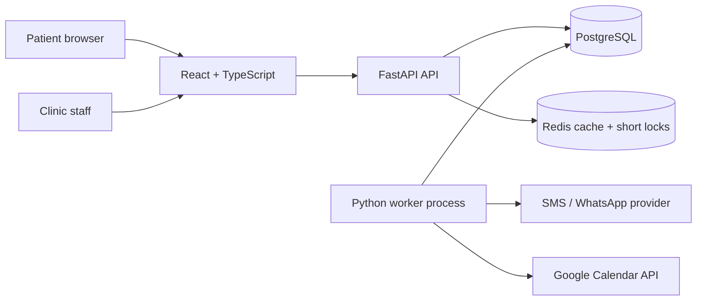

# SlotFlow system design

## Goal and scale

Reduce missed appointments and refill cancellations for small clinics. The first deployment targets a few clinics and thousands of appointments per month. A modular monolith keeps booking, scheduling, waitlist, and messaging in one transaction boundary; the API and worker run as separate processes from the same Python codebase.

PostgreSQL is the source of truth. Redis holds 20-second availability results and 10-second booking locks. The durable job queue and message outbox live in PostgreSQL so a Redis restart does not erase work.

## Booking invariant

1. Expand the provider's local weekly rules for the chosen date. Apply date exceptions, breaks, service duration, and active appointments.
2. Acquire a short Redis lock for provider plus UTC start. This reduces duplicate work; a Redis outage does not remove the database guarantee.
3. In a database transaction, check the request's idempotency key, compute availability again without cache, upsert the patient, insert the appointment, record the idempotency key, and schedule jobs.
4. PostgreSQL's GiST exclusion constraint rejects overlapping active time ranges for one provider, including races between API instances. A conflict returns HTTP 409.
5. Invalidate the provider/date availability cache.

The appointment range uses `[start, end)`, so an appointment ending at 10:30 and another starting at 10:30 are valid.

## Availability and time zones

Clinics store an IANA time zone such as `Asia/Kolkata`; recurring rules, breaks, and exceptions use local wall times. Appointment starts and ends use `timestamptz` and are exchanged as offset-bearing ISO timestamps. The slot generator steps by 15 local minutes, skips nonexistent times at a spring DST transition, and uses the earlier offset for repeated fall times. The API recalculates availability inside booking and rescheduling transactions because cached results are advisory.

## Waitlist and reminders

Cancellation locks the appointment, marks it cancelled, then selects the earliest matching waitlist entry using `FOR UPDATE SKIP LOCKED`. It creates a 15-minute offer, a unique outbox message, and an expiry job in the same transaction. The offer token books through the same overlap constraint. If the offer expires, the worker advances to the next eligible patient.

Booking creates a confirmation message and reminder jobs for 24 hours and 2 hours before the visit when those times are still ahead. A patient with a prior no-show also receives a 4-hour reminder. Short-notice bookings therefore get a confirmation without a burst of overdue reminders. Job rows have unique keys and are claimed with `FOR UPDATE SKIP LOCKED`, so multiple worker instances can share the queue. Processing jobs whose lock is older than five minutes are reclaimed after a crash. Each reminder writes to a uniquely keyed outbox row before any provider call.

For message sending, the worker marks an outbox row `sending` before calling Twilio. It records the provider SID on success. A timeout may mean Twilio accepted the text, so `sending` rows require operator reconciliation and are not retried automatically. This favors avoiding double texts over automatic recovery of an ambiguous send. Without Twilio credentials, local runs log a dry-run message.

Google Calendar sync is another durable job. Event IDs derive from appointment UUIDs, so a repeated create becomes an update. Cancellation removes the event. External API failures retry with bounded backoff.

## API and access

| Endpoint | Access | Purpose |
| --- | --- | --- |
| `GET /api/public` | Public | Clinic, services, providers |
| `GET /api/availability` | Public | Open starts for date, provider, service |
| `POST /api/appointments` | Public | Idempotent booking |
| `POST /api/waitlist` | Public | Join a waitlist |
| `POST /api/offer/{token}` | Offer token | Claim a released slot |
| `POST /api/admin/login` | Staff password | Set signed, HTTP-only session cookie |
| `GET /api/bootstrap` | Staff | Dashboard data |
| `PATCH /api/appointments/{id}` | Staff | Status or reschedule |

The included staff password is a prototype gate. Before real patient data, add individual accounts, roles, audit logs, consent and opt-out handling, retention policies, and clinic-scoped authorization.

## Failure behavior and growth

| Failure | Behavior |
| --- | --- |
| Two patients choose one slot | One insert succeeds; the exclusion constraint rejects the other. |
| Redis unavailable | Read availability from PostgreSQL and rely on its overlap constraint. |
| Worker restarts | Pending jobs remain in PostgreSQL; stale processing jobs are reclaimed. |
| Twilio request times out | Keep `sending` for reconciliation to avoid an automatic duplicate. |
| Calendar API fails | Retry the durable calendar job with backoff. |
| Waitlist offer expires | Mark it expired and offer the slot to the next eligible patient. |

Track booking conflicts, open-slot conversion, reminder delivery, no-show rate by cohort, queue age, outbox rows stuck in `sending`, and calendar sync failures. Add per-clinic tenancy and individual staff roles before onboarding multiple clinics. If job volume outgrows the database queue, move job transport to a dedicated broker while keeping the transactional outbox in PostgreSQL.

The **28% to 11%** result shown in the UI is illustrative content from the project brief, not a measured outcome of this installation.
